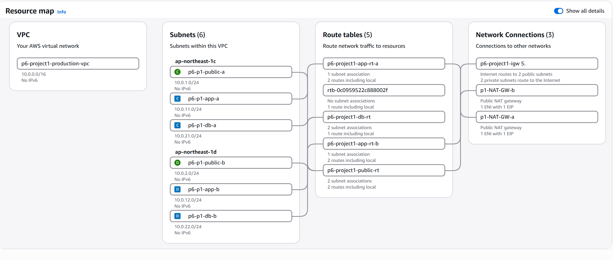
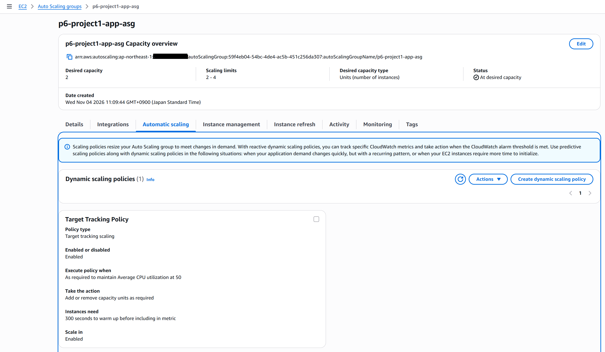
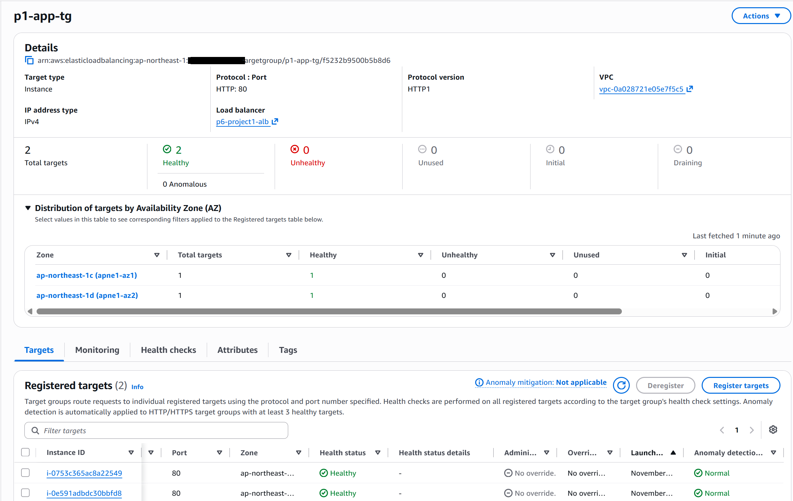
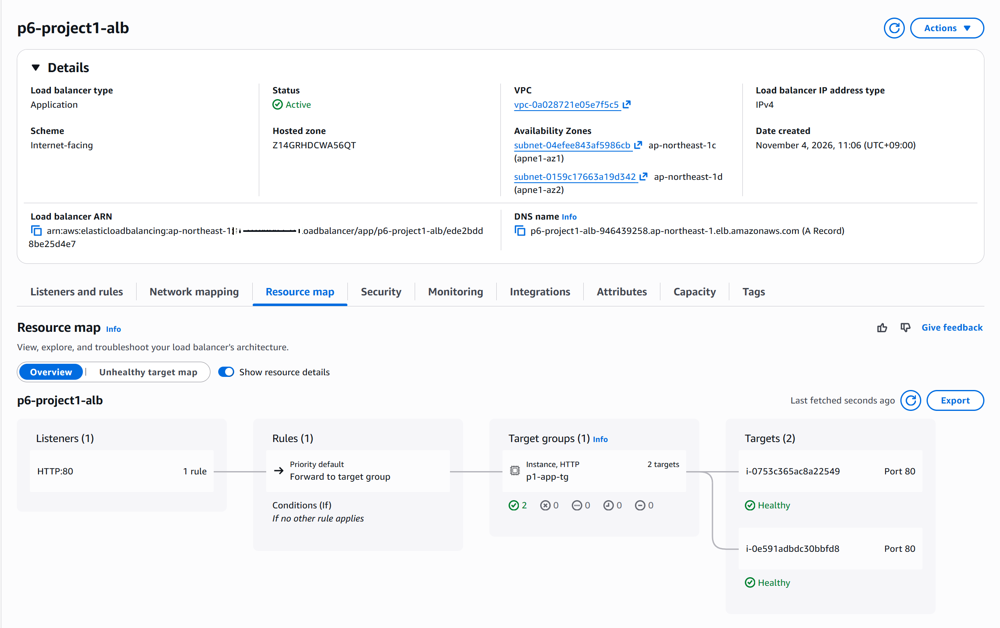
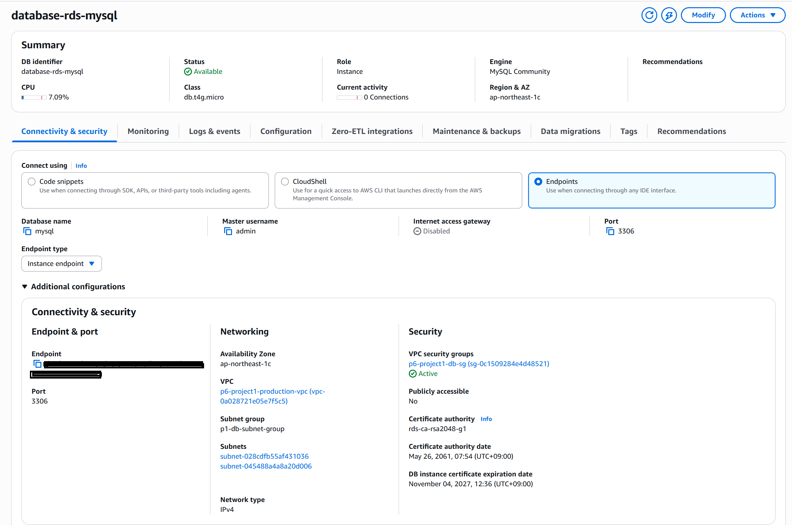

# AWS Production 3-Tier Architecture

## Project Overview

This project demonstrates a production-style 3-tier architecture on AWS, designed with network segmentation, high availability at the application tier, controlled access, and database connectivity.

The infrastructure was built using the AWS Management Console in the Tokyo region (`ap-northeast-1`).

## Architecture

The architecture consists of three logical tiers:

1. **Web / Load Balancing Tier** — An internet-facing Application Load Balancer distributes HTTP traffic across application instances.
2. **Application Tier** — Amazon EC2 instances run Apache HTTP Server and are managed by an Auto Scaling Group across two Availability Zones.
3. **Database Tier** — Amazon RDS for MySQL is deployed in private database subnets.

## AWS Services Used

- Amazon VPC
- Public and private subnets
- Internet Gateway
- NAT Gateways
- Route Tables
- Security Groups
- Application Load Balancer
- EC2 Launch Template
- EC2 Auto Scaling Group
- Target Tracking Scaling Policy
- Amazon RDS for MySQL
- AWS Systems Manager Session Manager

## Network Design

- VPC CIDR: `10.0.0.0/16`
- Public subnet A: `10.0.1.0/24`
- Public subnet B: `10.0.2.0/24`
- Application subnet A: `10.0.11.0/24`
- Application subnet B: `10.0.12.0/24`
- Database subnet A: `10.0.21.0/24`
- Database subnet B: `10.0.22.0/24`

The application instances are deployed in private subnets across two Availability Zones. Each application subnet uses a NAT Gateway in its own Availability Zone for outbound internet access.

The database subnets do not have a direct internet route.

## Security Design

Security groups enforce tier-to-tier communication:

- ALB Security Group: Allows inbound HTTP traffic on port 80.
- Application Security Group: Allows HTTP traffic only from the ALB Security Group.
- Database Security Group: Allows MySQL traffic on port 3306 only from the Application Security Group.

The RDS instance is not publicly accessible.

## High Availability and Scaling

- Application Load Balancer deployed across two public subnets.
- EC2 Auto Scaling Group deployed across two Availability Zones.
- Desired capacity: 2 instances.
- Minimum capacity: 2 instances.
- Maximum capacity: 4 instances.
- Target tracking policy based on average CPU utilization (50%).

## Database Configuration

Amazon RDS for MySQL is deployed in private database subnets.

**Availability limitation:** The database uses Single-AZ deployment to keep the learning project within a limited budget. It does not provide automatic Multi-AZ database failover.

Database connectivity was tested from an EC2 application instance using AWS Systems Manager Session Manager. A test database and table were created, and sample records were successfully queried.

## Testing and Validation

- Verified that the Application Load Balancer serves the application page.
- Confirmed that both EC2 targets registered with the target group are healthy.
- Verified EC2-to-RDS MySQL connectivity.
- Created and queried sample employee records in MySQL.
- Configured an Auto Scaling target tracking policy.

## Design Considerations

This project prioritizes practical AWS infrastructure skills:

- Network segmentation
- Private application and database tiers
- Security group referencing
- Multi-AZ application deployment
- Load balancing
- Auto Scaling
- Database connectivity
- Cost-aware architecture decisions

## Limitations and Future Improvements

- Enable Multi-AZ RDS for database high availability when budget permits.
- Configure HTTPS using AWS Certificate Manager.
- Add CloudWatch dashboards and alarms.
- Automate infrastructure deployment using AWS CloudFormation or Terraform.
- Move database credentials into AWS Secrets Manager or Systems Manager Parameter Store.
- Deploy the database-backed application consistently through the Launch Template.

## Cleanup

AWS resources such as NAT Gateways, Elastic IP addresses, Load Balancers, EC2 instances, and RDS instances can incur charges.

Delete resources when they are no longer needed to avoid unexpected costs.

---

**AWS Region:** Asia Pacific (Tokyo) — `ap-northeast-1`  
**Project:** AWS SAA-C03 Portfolio — Production 3-Tier Architecture

## Infrastructure Screenshots

### 1. VPC Resource Map

### 2. Auto Scaling Group

### 3. Target Group Health

### 4. Application Load Balancer

### 5. Amazon RDS Configuration

